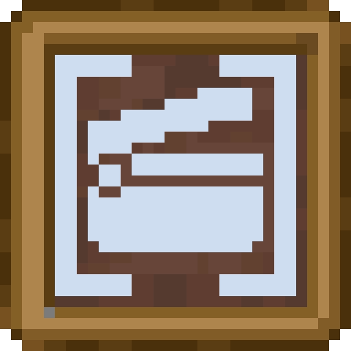
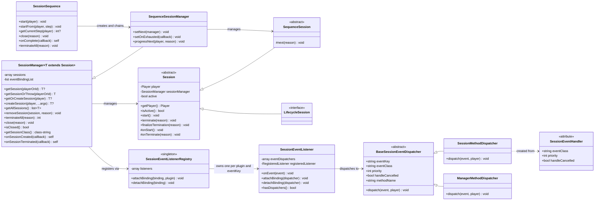

<!-- PROJECT BADGES -->
<div align="center">

[![Packagist][packagist-badge]][packagist-url]
[![CI][ci-badge]][ci-url]
[![Stars][stars-badge]][stars-url]
[![License][license-badge]][license-url]

</div>


<!-- PROJECT LOGO -->
<br />
<div align="center">
  
  <h3>session-utils</h3>
  <p align="center">
    Per-player sessions for PocketMine-MP, created, routed and cleaned up for you.

[Packagist][packagist-url] · [Changelog](CHANGELOG.md) · [Report a bug][issues-url] · [Request a feature][issues-url]

[한국어 README](README_KOR.md)

  </p>
</div>

```php
final class CombatSession extends Session implements LifecycleSession{
    protected function onStart() : void{ /* player joined */ }
    protected function onTerminate(string $reason) : void{ /* player left, plugin disabled, ... */ }

    #[SessionEventHandler(EntityDamageByEntityEvent::class)]
    public function onHit(EntityDamageByEntityEvent $event) : void{ /* only for this player's session */ }
}

new SessionManager($this, CombatSession::class); // that is all the wiring
```

-----

## 🌟 Why session-utils?

Almost every plugin keeps some state per player: a selection, a minigame state, a tutorial step, a cooldown.
That means a `PlayerJoinEvent` / `PlayerQuitEvent` listener, an array keyed by player, event listeners that look the
player up and ignore everyone else, and cleanup when the plugin is disabled. This library does it once, correctly:

- **No listener classes** : mark a method with `#[SessionEventHandler]` and it only runs for the player who owns the session
- **Automatic lifecycle** : lifecycle sessions are created on join (and for players already online) and terminated on quit
- **Safe shutdown** : the manager closes itself when its plugin is disabled, no `onDisable()` code needed
- **Multi-step flows** : `SessionSequence` chains sessions for tutorials, quests and wizards
- **One PMMP listener per event** : many session types listening to the same event share a single registered listener
- **Predictable termination** : `onTerminate()` first, then the `onSessionTerminated` callback, each exactly once
- **Failures stay contained** : an exception in `onStart()`, `onTerminate()` or a callback is logged, never thrown into the server
- **Tested** : run against the real server code on PHP 8.4 / 8.5

## 🎯 Use cases

| You are building...                          | Use                                                       |
|----------------------------------------------|-----------------------------------------------------------|
| Per-player stats, combat tags, scoreboards   | A lifecycle session (`LifecycleSession`)                  |
| Region selection, build tools, edit modes    | A task session with `createSession()` / `removeSession()` |
| Tutorials, quests, onboarding                | `SessionSequence`                                         |
| Confirmation prompts, chat input flows       | A task session that terminates itself when done           |

-----

## 📦 Installation

```sh
composer require presentkim/session-utils
```

| Requirement | Version                                                           |
|-------------|-------------------------------------------------------------------|
| Server      | [axolotl-pm/PocketMine-MP][axolotl-url] (fork of PocketMine-MP 5) |
| PHP         | **8.4** or newer                                                  |

> The Poggit virion for the original PocketMine-MP 5.44 and older is kept on the
> [`legacy/pmmp-5.44`][legacy-url] branch (no longer maintained).

-----

## 🧠 Concepts

|           | Lifecycle session                  | Task session                   |
|-----------|------------------------------------|--------------------------------|
| Interface | `LifecycleSession`                 | (none)                         |
| Created   | Automatically on `PlayerJoinEvent`, and when the manager is constructed for players already online | Manually via `createSession()` |
| Destroyed | Automatically on `PlayerQuitEvent` | Manually via `removeSession()` or `terminate()` |
| Use case  | Per-player persistent state        | On-demand feature sessions     |

- A `SessionManager` handles exactly one session class. Create one manager per session type.
- A session belongs to one player and is **active** between `start()` and `terminate()`.
  Calling `terminate()` inside a session removes it from its manager.
- Sessions of a `SessionSequence` extend `SequenceSession` and are **not** lifecycle sessions.
- A manager **closes itself** when its owning plugin is disabled (all sessions are terminated with
  `PLUGIN_DISABLE` and all listeners are detached). A closed manager throws `LogicException` from
  `createSession()` and `getOrCreateSession()`.

-----

## 🚀 Quick start

### 1. Define a lifecycle session

Extend `Session` and implement `LifecycleSession` for automatic join/quit management.
Declare event handlers with `#[SessionEventHandler]`: no separate listener class needed.

```php
use pocketmine\event\block\BlockBreakEvent;
use pocketmine\event\player\PlayerInteractEvent;
use kim\present\utils\session\Session;
use kim\present\utils\session\LifecycleSession;
use kim\present\utils\session\SessionTerminateReasons;
use kim\present\utils\session\listener\attribute\SessionEventHandler;

final class WorldEditSession extends Session implements LifecycleSession{

    private ?array $pos1 = null;
    private ?array $pos2 = null;

    protected function onStart() : void{
        $this->getPlayer()->sendMessage("WorldEdit session started.");
    }

    protected function onTerminate(string $reason) : void{
        // save state, clean up, etc.
    }

    #[SessionEventHandler(BlockBreakEvent::class)]
    public function onBlockBreak(BlockBreakEvent $event) : void{
        $pos = $event->getBlock()->getPosition();
        $this->pos1 = [$pos->x, $pos->y, $pos->z];
        $event->cancel();
    }

    #[SessionEventHandler(PlayerInteractEvent::class)]
    public function onInteract(PlayerInteractEvent $event) : void{
        $pos = $event->getBlock()->getPosition();
        $this->pos2 = [$pos->x, $pos->y, $pos->z];

        if($this->pos1 !== null){
            // Self-terminate when both positions are selected
            $this->terminate(SessionTerminateReasons::COMPLETED);
        }
    }
}
```

### 2. Bootstrap from your plugin

```php
use pocketmine\plugin\PluginBase;
use kim\present\utils\session\SessionManager;

final class MyPlugin extends PluginBase{
    private SessionManager $sessionManager;

    protected function onEnable() : void{
        $this->sessionManager = new SessionManager($this, WorldEditSession::class);

        $this->sessionManager
            ->onSessionCreated(function(WorldEditSession $session) : void{
                // e.g. log session start
            })
            ->onSessionTerminated(function(WorldEditSession $session, string $reason) : void{
                // e.g. persist state to DB
            });
    }

    // No onDisable() needed: the manager closes itself when MyPlugin is disabled,
    // terminating every session with SessionTerminateReasons::PLUGIN_DISABLE.
}
```

That is the whole setup. Every player who joins gets a `WorldEditSession`, and so do the players already online
when `new SessionManager(...)` runs (for example after a late enable).

### 3. Manage sessions manually

```php
// Create a session on demand (for non-lifecycle sessions); extra arguments go to the session constructor
$session = $this->sessionManager->createSession($player);

// Retrieve a session (returns null if none exists)
$session = $this->sessionManager->getSession($player);

// Retrieve a session or throw RuntimeException if none exists
$session = $this->sessionManager->getSessionOrThrow($player);

// Retrieve a session or create one if none exists
$session = $this->sessionManager->getOrCreateSession($player);

// All active sessions
$sessions = $this->sessionManager->getAllSessions();

// Remove a specific session (a player without a session is ignored)
$this->sessionManager->removeSession($player, SessionTerminateReasons::MANUAL);

// Terminate every session and keep using the manager
$count = $this->sessionManager->terminateAll(SessionTerminateReasons::MAINTENANCE);

// Close the manager early (also done automatically when the plugin is disabled)
$this->sessionManager->close();
$this->sessionManager->isClosed(); // true; createSession() now throws LogicException
```

`createSession()` returns the existing session if the player already has one. If the session throws while it is
created or started, the error is logged, the session is terminated with `START_FAILED` and `null` is returned.

### 4. Define a sequence session

For multi-step flows (e.g. tutorials), extend `SequenceSession` and call `next()` to advance to the next step.

```php
use pocketmine\event\block\BlockBreakEvent;
use pocketmine\event\block\BlockPlaceEvent;
use kim\present\utils\session\sequence\SequenceSession;
use kim\present\utils\session\listener\attribute\SessionEventHandler;

final class TutorialStep1Session extends SequenceSession{

    protected function onStart() : void{
        $this->getPlayer()->sendMessage("Step 1: Break a block.");
    }

    protected function onTerminate(string $reason) : void{}

    #[SessionEventHandler(BlockBreakEvent::class)]
    public function onBlockBreak(BlockBreakEvent $event) : void{
        $this->getPlayer()->sendMessage("Step 1 complete!");
        $this->next(); // Advances to TutorialStep2Session
    }
}

final class TutorialStep2Session extends SequenceSession{

    protected function onStart() : void{
        $this->getPlayer()->sendMessage("Step 2: Place a block.");
    }

    protected function onTerminate(string $reason) : void{}

    #[SessionEventHandler(BlockPlaceEvent::class)]
    public function onBlockPlace(BlockPlaceEvent $event) : void{
        $this->getPlayer()->sendMessage("Step 2 complete!");
        $this->next(); // No next step: triggers the onComplete callback
    }
}
```

### 5. Bootstrap a sequence

```php
use pocketmine\plugin\PluginBase;
use pocketmine\player\Player;
use kim\present\utils\session\sequence\SessionSequence;

final class MyPlugin extends PluginBase{
    private SessionSequence $tutorialSequence;

    protected function onEnable() : void{
        $this->tutorialSequence = new SessionSequence($this,
            TutorialStep1Session::class,
            TutorialStep2Session::class,
        );

        $this->tutorialSequence->onComplete(function(Player $player) : void{
            $player->sendMessage("Tutorial complete!");
            $this->saveProgress($player, completed: true);
        });
    }

    public function startTutorial(Player $player) : void{
        $progress = $this->loadProgress($player); // e.g. 0, 1

        if($progress === 0){
            $this->tutorialSequence->start($player);
        }else{
            // Resume from where the player left off (by index or class-string)
            $this->tutorialSequence->startFrom($player, $progress);
        }
    }

    public function whereIsPlayer(Player $player) : ?int{
        return $this->tutorialSequence->getCurrentStep($player); // 0-based step index, or null
    }
}
```

`start()` and `startFrom()` first terminate the player's session in any other step with `RESTART`, so a player is
never in two steps at once. Like a manager, a sequence closes itself when the plugin is disabled.

-----

## 📚 Examples

<details>
<summary><b>Per-player cooldown on a lifecycle session</b></summary>

```php
final class CooldownSession extends Session implements LifecycleSession{
    private float $until = 0.0;

    protected function onStart() : void{}
    protected function onTerminate(string $reason) : void{}

    public function use(float $seconds) : bool{
        $now = microtime(true);
        if($now < $this->until){
            return false;
        }
        $this->until = $now + $seconds;
        return true;
    }
}

// somewhere in a command or event handler
$session = $this->cooldowns->getSessionOrThrow($player);
if(!$session->use(5.0)){
    $player->sendMessage("Wait a moment!");
}
```

</details>

<details>
<summary><b>Task session with a timeout</b></summary>

```php
final class ConfirmSession extends Session{
    private ?TaskHandler $timeout = null;

    public function __construct(SessionManager $sessionManager, Player $player, private readonly PluginBase $plugin){
        parent::__construct($sessionManager, $player);
    }

    protected function onStart() : void{
        $this->getPlayer()->sendMessage("Type 'yes' within 10 seconds.");
        $this->timeout = $this->plugin->getScheduler()->scheduleDelayedTask(
            new ClosureTask(fn() => $this->terminate(SessionTerminateReasons::TIMEOUT)),
            20 * 10
        );
    }

    protected function onTerminate(string $reason) : void{
        $this->timeout?->cancel();
    }

    #[SessionEventHandler(PlayerChatEvent::class)]
    public function onChat(PlayerChatEvent $event) : void{
        if(strtolower($event->getMessage()) === "yes"){
            $event->cancel();
            $this->terminate(SessionTerminateReasons::COMPLETED);
        }
    }
}

// $this->confirms = new SessionManager($this, ConfirmSession::class);
// $this->confirms->createSession($player, $this); // extra arguments go to the constructor
```

Extra arguments of `createSession($player, ...$args)` are forwarded to your session constructor after the manager
and the player, so a session can receive the plugin or any other data it needs.

</details>

<details>
<summary><b>Reacting to termination</b></summary>

```php
$this->sessionManager->onSessionTerminated(function(WorldEditSession $session, string $reason) : void{
    if($reason === SessionTerminateReasons::PLAYER_QUIT){
        $this->database->save($session->getPlayer()->getName(), $session->exportState());
    }
});
```

The callback may type its parameter with your concrete session class. The order is always:
`Session::onTerminate()` first, then the callback, each exactly once.

</details>

-----

## 📖 API reference

### `SessionManager`

Namespace `kim\present\utils\session`. One manager per session class.

| Method                                              | Description                                                                                       |
|-----------------------------------------------------|---------------------------------------------------------------------------------------------------|
| `__construct(PluginBase $plugin, string $sessionClass)` | Registers the session's event handlers and the plugin-disable hook. Lifecycle sessions are also created for players already online |
| `getSessionClass(): string`                         | The session class this manager handles                                                            |
| `getSession(Player\|int $playerOrId): ?Session`     | The active session, or `null`. Accepts a player or a runtime ID                                   |
| `getSessionOrThrow(Player\|int $playerOrId): Session` | The active session, or `RuntimeException` if none exists                                        |
| `createSession(Player $player, mixed ...$args): ?Session` | Creates and starts a session, or returns the existing one. `null` on failure (logged). Throws `LogicException` when closed |
| `getOrCreateSession(Player $player): ?Session`      | The existing session, or a newly created one                                                      |
| `getAllSessions(): list<Session>`                   | Every active session                                                                              |
| `removeSession(Session\|Player $session, string $reason = MANUAL): void` | Terminates and removes a session. No-op if there is none, or if the given `Session` object is stale |
| `terminateAll(string $reason = MANUAL): int`        | Terminates every session, returns how many                                                        |
| `onSessionCreated(Closure $callback): self`         | `fn(Session): void`, called after a session is created and started (not when start failed)        |
| `onSessionTerminated(Closure $callback): self`      | `fn(Session, string $reason): void`, called after `onTerminate()`                                 |
| `close(string $reason = PLUGIN_DISABLE): void`      | Terminates every session and detaches all listeners. Idempotent                                   |
| `isClosed(): bool`                                  | Whether `close()` has been called                                                                 |

### `Session`

| Method                                  | Description                                                                          |
|-----------------------------------------|--------------------------------------------------------------------------------------|
| `getPlayer(): Player`                   | The owning player                                                                    |
| `isActive(): bool`                      | `true` between `start()` and `terminate()`                                           |
| `terminate(string $reason = MANUAL)`    | Removes this session from its manager. No-op if it is already terminated             |
| `protected onStart(): void`             | Hook, called once when the session starts                                            |
| `protected onTerminate(string $reason)` | Hook, called once when the session ends                                              |

### `SequenceSession` and `SessionSequence`

Namespace `kim\present\utils\session\sequence`.

| Method                                             | Description                                                                              |
|----------------------------------------------------|------------------------------------------------------------------------------------------|
| `SequenceSession::next(string $reason = COMPLETED)` | Terminates this session and starts the next step, or calls `onComplete` on the last step. No-op when the session is no longer active |
| `new SessionSequence(PluginBase $plugin, string ...$sessionClasses)` | Steps in order. Throws `InvalidArgumentException` for no classes, a class that is not a `SequenceSession`, or one that implements `LifecycleSession` |
| `start(Player $player): void`                      | Starts from the first step                                                               |
| `startFrom(Player $player, int\|string $step): void` | Starts from a 0-based index or a session class name. Throws `InvalidArgumentException` for an unknown step |
| `getCurrentStep(Player $player): ?int`             | 0-based index of the player's current step, or `null`                                    |
| `getSessionClassAt(int $index): ?string`           | The session class of a step, or `null` if out of range                                   |
| `onComplete(Closure $callback): self`              | `fn(Player): void`, called when the last step calls `next()`                             |
| `terminateAll(string $reason = MANUAL): void`      | Terminates every active session of every step                                            |
| `close(string $reason = PLUGIN_DISABLE): void`     | Closes every step's manager. Also done automatically when the plugin is disabled         |

### `#[SessionEventHandler]`

```php
#[SessionEventHandler(string $eventClass, int $priority = EventPriority::NORMAL, bool $handleCancelled = true)]
```

Can be repeated on one method for different events. The method must be `public` and take exactly one non-nullable
`Event` parameter; otherwise it is skipped with a warning in the plugin log.

### Termination reasons

`terminate(string $reason)` accepts any string. Built-in constants are provided by `SessionTerminateReasons`:

| Constant         | Value              | Description                          |
|------------------|--------------------|--------------------------------------|
| `MANUAL`         | `"manual"`         | Explicitly terminated by plugin code |
| `PLAYER_QUIT`    | `"player_quit"`    | Player disconnected                  |
| `PLUGIN_DISABLE` | `"plugin_disable"` | Owning plugin was disabled           |
| `START_FAILED`   | `"start_failed"`   | Session failed to initialize         |
| `COMPLETED`      | `"completed"`      | Session reached its end state        |
| `CANCELLED`      | `"cancelled"`      | Session abandoned before completion  |
| `TIMEOUT`        | `"timeout"`        | Session exceeded allotted time       |
| `RESTART`        | `"restart"`        | Session terminated to restart fresh  |
| `MAINTENANCE`    | `"maintenance"`    | Server maintenance                   |

-----

## 🏗️ Architecture

<details>
<summary><b>Class diagram, event flow and components</b></summary>



### Event flow

```
PMMP fires event
  → SessionEventListener::onEvent()
    → [cancelled mid-dispatch? stop if handleCancelled=false]
    → BaseSessionEventDispatcher::dispatch()
      ├─ SessionMethodDispatcher → SessionManager::getSession(player) → Session::{methodName}(event)
      └─ ManagerMethodDispatcher → SessionManager::{methodName}(event)
```

### Components

- **`SessionEventListenerRegistry`** (singleton) keeps one PMMP listener per `(plugin, eventClass, priority, handleCancelled)`.
  Several session types of the same plugin that handle the same event share it. Listeners are never shared between
  plugins, because PocketMine-MP unregisters a plugin's listeners when it is disabled. This keeps the library safe
  when a single Composer copy is used by several plugins.
- **`SessionEventListener`** is the registered listener for one such key. It routes each fired event to its dispatchers
  in registration order and respects cancellation mid-dispatch.
- **`BaseSessionEventDispatcher`** holds the listener configuration and defines `dispatch()`.
  `SessionMethodDispatcher` calls the bound method on the player's active session;
  `ManagerMethodDispatcher` calls a method on the manager (used for join/quit).
- **`SequenceSessionManager`** is the internal manager `SessionSequence` creates per step. Do not use it directly.
- **Termination** always runs `onTerminate()` and then the `onSessionTerminated` callback, once each, whether it was
  triggered by `terminate()`, `removeSession()`, a quit, a restart or `close()`.

### File structure

```
src/kim/present/utils/session/
├── Session.php
├── LifecycleSession.php
├── SessionManager.php
├── SessionTerminateReasons.php
├── sequence/
│   ├── SequenceSession.php
│   ├── SequenceSessionManager.php
│   └── SessionSequence.php
└── listener/
    ├── SessionEventListener.php
    ├── SessionEventListenerRegistry.php
    ├── attribute/
    │   └── SessionEventHandler.php
    └── dispatcher/
        ├── BaseSessionEventDispatcher.php
        ├── SessionMethodDispatcher.php
        └── ManagerMethodDispatcher.php
```

</details>

-----

## 🧪 Development

```sh
composer install --ignore-platform-req='ext-*'
composer test
```

The tests use the real `axolotl-pm/pocketmine-mp` code without its native extensions.

-----

## 📄 License

Distributed under the **MIT** License. See [LICENSE][license-url] for more information.


[packagist-badge]: https://img.shields.io/packagist/v/presentkim/session-utils.svg?style=for-the-badge

[packagist-url]: https://packagist.org/packages/presentkim/session-utils

[ci-badge]: https://img.shields.io/github/actions/workflow/status/presentkim-pm/session-utils/ci.yml?branch=main&style=for-the-badge

[ci-url]: https://github.com/presentkim-pm/session-utils/actions/workflows/ci.yml

[stars-badge]: https://img.shields.io/github/stars/presentkim-pm/session-utils.svg?style=for-the-badge

[license-badge]: https://img.shields.io/github/license/presentkim-pm/session-utils.svg?style=for-the-badge

[stars-url]: https://github.com/presentkim-pm/session-utils/stargazers

[issues-url]: https://github.com/presentkim-pm/session-utils/issues

[license-url]: https://github.com/presentkim-pm/session-utils/blob/main/LICENSE

[legacy-url]: https://github.com/presentkim-pm/session-utils/tree/legacy/pmmp-5.44

[axolotl-url]: https://github.com/axolotl-pm/PocketMine-MP
