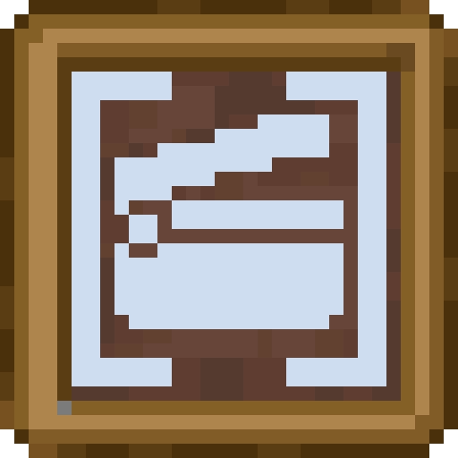
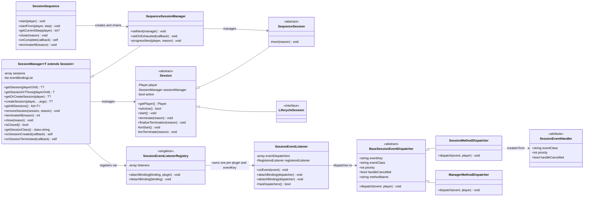

<!-- PROJECT BADGES -->
<div align="center">

[![Packagist][packagist-badge]][packagist-url]
[![CI][ci-badge]][ci-url]
[![Stars][stars-badge]][stars-url]
[![License][license-badge]][license-url]

</div>


<!-- PROJECT LOGO -->
<br />
<div align="center">
  
  <h3>session-utils</h3>
  <p align="center">
    PocketMine-MP 플레이어별 세션을 자동으로 생성하고, 이벤트를 연결하고, 정리해 줍니다.

[Packagist][packagist-url] · [변경 내역](CHANGELOG.md) · [버그 제보][issues-url] · [기능 요청][issues-url]

[English README](README.md)

  </p>
</div>

```php
final class CombatSession extends Session implements LifecycleSession{
    protected function onStart() : void{ /* player joined */ }
    protected function onTerminate(string $reason) : void{ /* player left, plugin disabled, ... */ }

    #[SessionEventHandler(EntityDamageByEntityEvent::class)]
    public function onHit(EntityDamageByEntityEvent $event) : void{ /* only for this player's session */ }
}

new SessionManager($this, CombatSession::class); // that is all the wiring
```

-----

## 🌟 왜 session-utils인가요?

거의 모든 플러그인은 플레이어마다 상태를 가집니다. 영역 선택, 미니게임 상태, 튜토리얼 단계, 쿨다운 같은 것들입니다.
그래서 `PlayerJoinEvent` / `PlayerQuitEvent` 리스너, 플레이어로 키를 잡은 배열, 플레이어를 찾아서 나머지는 무시하는 이벤트 리스너,
플러그인 비활성화 시의 정리 코드를 매번 작성하게 됩니다. 이 라이브러리가 이를 한 번에 올바르게 처리합니다.

- **리스너 클래스 불필요** : 메서드에 `#[SessionEventHandler]`를 붙이면 해당 세션을 가진 플레이어에게만 실행됩니다
- **자동 라이프사이클** : 라이프사이클 세션은 접속 시(그리고 이미 접속해 있던 플레이어에게도) 생성되고 퇴장 시 종료됩니다
- **안전한 종료** : 소유 플러그인이 비활성화되면 매니저가 스스로 닫히므로 `onDisable()` 코드가 필요 없습니다
- **다단계 흐름** : `SessionSequence`로 튜토리얼, 퀘스트, 마법사형 흐름을 이어 붙일 수 있습니다
- **이벤트당 PMMP 리스너 하나** : 같은 이벤트를 듣는 여러 세션 타입이 하나의 등록된 리스너를 공유합니다
- **예측 가능한 종료 순서** : `onTerminate()`가 먼저, 그 다음 `onSessionTerminated` 콜백이 각각 정확히 한 번 실행됩니다
- **실패는 격리** : `onStart()`, `onTerminate()`, 콜백에서 발생한 예외는 서버로 던져지지 않고 로그로 남습니다
- **테스트됨** : 실제 서버 코드를 대상으로 PHP 8.4 / 8.5에서 실행합니다

## 🎯 사용 사례

| 만들려는 것                          | 사용할 것                                                 |
|--------------------------------------|-----------------------------------------------------------|
| 플레이어별 통계, 전투 태그, 스코어보드 | 라이프사이클 세션 (`LifecycleSession`)                    |
| 영역 선택, 건축 도구, 편집 모드      | `createSession()` / `removeSession()`을 쓰는 태스크 세션  |
| 튜토리얼, 퀘스트, 온보딩             | `SessionSequence`                                         |
| 확인 프롬프트, 채팅 입력 흐름        | 끝나면 스스로 종료하는 태스크 세션                        |

-----

## 📦 설치

```sh
composer require presentkim/session-utils
```

| 요구사항 | 버전                                                              |
|----------|-------------------------------------------------------------------|
| 서버     | [axolotl-pm/PocketMine-MP][axolotl-url] (PocketMine-MP 5 포크)    |
| PHP      | **8.4** 이상                                                      |

> 원본 PocketMine-MP 5.44 이하용 Poggit virion은 [`legacy/pmmp-5.44`][legacy-url] 브랜치에 보관되어 있습니다
> (더 이상 유지보수되지 않습니다).

-----

## 🧠 개념

|        | 라이프사이클 세션                  | 태스크 세션                   |
|--------|------------------------------------|-------------------------------|
| 인터페이스 | `LifecycleSession`             | (없음)                        |
| 생성   | `PlayerJoinEvent`에서 자동, 그리고 매니저 생성 시 이미 접속 중인 플레이어에게도 자동 | `createSession()`으로 수동 |
| 소멸   | `PlayerQuitEvent`에서 자동         | `removeSession()` 또는 `terminate()`로 수동 |
| 용도   | 플레이어별 지속 상태               | 필요할 때 쓰는 기능 세션      |

- `SessionManager` 하나는 정확히 한 세션 클래스만 다룹니다. 세션 타입마다 매니저를 하나씩 만드세요.
- 세션은 한 플레이어에 속하며 `start()`부터 `terminate()`까지 **활성** 상태입니다.
  세션 안에서 `terminate()`를 호출하면 매니저에서 스스로 제거됩니다.
- `SessionSequence`의 세션은 `SequenceSession`을 상속하며 라이프사이클 세션이 **아닙니다**.
- 소유 플러그인이 비활성화되면 매니저는 **스스로 닫힙니다** (모든 세션이 `PLUGIN_DISABLE`로 종료되고 모든 리스너가 분리됩니다).
  닫힌 매니저의 `createSession()`과 `getOrCreateSession()`은 `LogicException`을 던집니다.

-----

## 🚀 빠른 시작

### 1. 라이프사이클 세션 정의

`Session`을 상속하고 `LifecycleSession`을 구현하면 접속/퇴장 관리가 자동으로 됩니다.
이벤트 핸들러는 `#[SessionEventHandler]`로 선언하며 별도의 리스너 클래스는 필요 없습니다.

```php
use pocketmine\event\block\BlockBreakEvent;
use pocketmine\event\player\PlayerInteractEvent;
use kim\present\utils\session\Session;
use kim\present\utils\session\LifecycleSession;
use kim\present\utils\session\SessionTerminateReasons;
use kim\present\utils\session\listener\attribute\SessionEventHandler;

final class WorldEditSession extends Session implements LifecycleSession{

    private ?array $pos1 = null;
    private ?array $pos2 = null;

    protected function onStart() : void{
        $this->getPlayer()->sendMessage("WorldEdit session started.");
    }

    protected function onTerminate(string $reason) : void{
        // save state, clean up, etc.
    }

    #[SessionEventHandler(BlockBreakEvent::class)]
    public function onBlockBreak(BlockBreakEvent $event) : void{
        $pos = $event->getBlock()->getPosition();
        $this->pos1 = [$pos->x, $pos->y, $pos->z];
        $event->cancel();
    }

    #[SessionEventHandler(PlayerInteractEvent::class)]
    public function onInteract(PlayerInteractEvent $event) : void{
        $pos = $event->getBlock()->getPosition();
        $this->pos2 = [$pos->x, $pos->y, $pos->z];

        if($this->pos1 !== null){
            // Self-terminate when both positions are selected
            $this->terminate(SessionTerminateReasons::COMPLETED);
        }
    }
}
```

### 2. 플러그인에서 부트스트랩

```php
use pocketmine\plugin\PluginBase;
use kim\present\utils\session\SessionManager;

final class MyPlugin extends PluginBase{
    private SessionManager $sessionManager;

    protected function onEnable() : void{
        $this->sessionManager = new SessionManager($this, WorldEditSession::class);

        $this->sessionManager
            ->onSessionCreated(function(WorldEditSession $session) : void{
                // e.g. log session start
            })
            ->onSessionTerminated(function(WorldEditSession $session, string $reason) : void{
                // e.g. persist state to DB
            });
    }

    // No onDisable() needed: the manager closes itself when MyPlugin is disabled,
    // terminating every session with SessionTerminateReasons::PLUGIN_DISABLE.
}
```

이것이 설정의 전부입니다. 접속하는 모든 플레이어가 `WorldEditSession`을 받고, `new SessionManager(...)`가 실행될 때
이미 접속해 있던 플레이어(예: 늦게 활성화된 경우)도 받습니다.

### 3. 수동 세션 관리

```php
// Create a session on demand (for non-lifecycle sessions); extra arguments go to the session constructor
$session = $this->sessionManager->createSession($player);

// Retrieve a session (returns null if none exists)
$session = $this->sessionManager->getSession($player);

// Retrieve a session or throw RuntimeException if none exists
$session = $this->sessionManager->getSessionOrThrow($player);

// Retrieve a session or create one if none exists
$session = $this->sessionManager->getOrCreateSession($player);

// All active sessions
$sessions = $this->sessionManager->getAllSessions();

// Remove a specific session (a player without a session is ignored)
$this->sessionManager->removeSession($player, SessionTerminateReasons::MANUAL);

// Terminate every session and keep using the manager
$count = $this->sessionManager->terminateAll(SessionTerminateReasons::MAINTENANCE);

// Close the manager early (also done automatically when the plugin is disabled)
$this->sessionManager->close();
$this->sessionManager->isClosed(); // true; createSession() now throws LogicException
```

`createSession()`은 플레이어에게 이미 세션이 있으면 기존 세션을 반환합니다. 세션 생성이나 시작 중 예외가 발생하면
오류를 로그에 남기고, 세션을 `START_FAILED`로 종료한 뒤 `null`을 반환합니다.

### 4. 시퀀스 세션 정의

튜토리얼 같은 다단계 흐름은 `SequenceSession`을 상속하고 `next()`를 호출해 다음 단계로 넘어갑니다.

```php
use pocketmine\event\block\BlockBreakEvent;
use pocketmine\event\block\BlockPlaceEvent;
use kim\present\utils\session\sequence\SequenceSession;
use kim\present\utils\session\listener\attribute\SessionEventHandler;

final class TutorialStep1Session extends SequenceSession{

    protected function onStart() : void{
        $this->getPlayer()->sendMessage("Step 1: Break a block.");
    }

    protected function onTerminate(string $reason) : void{}

    #[SessionEventHandler(BlockBreakEvent::class)]
    public function onBlockBreak(BlockBreakEvent $event) : void{
        $this->getPlayer()->sendMessage("Step 1 complete!");
        $this->next(); // Advances to TutorialStep2Session
    }
}

final class TutorialStep2Session extends SequenceSession{

    protected function onStart() : void{
        $this->getPlayer()->sendMessage("Step 2: Place a block.");
    }

    protected function onTerminate(string $reason) : void{}

    #[SessionEventHandler(BlockPlaceEvent::class)]
    public function onBlockPlace(BlockPlaceEvent $event) : void{
        $this->getPlayer()->sendMessage("Step 2 complete!");
        $this->next(); // No next step: triggers the onComplete callback
    }
}
```

### 5. 시퀀스 부트스트랩

```php
use pocketmine\plugin\PluginBase;
use pocketmine\player\Player;
use kim\present\utils\session\sequence\SessionSequence;

final class MyPlugin extends PluginBase{
    private SessionSequence $tutorialSequence;

    protected function onEnable() : void{
        $this->tutorialSequence = new SessionSequence($this,
            TutorialStep1Session::class,
            TutorialStep2Session::class,
        );

        $this->tutorialSequence->onComplete(function(Player $player) : void{
            $player->sendMessage("Tutorial complete!");
            $this->saveProgress($player, completed: true);
        });
    }

    public function startTutorial(Player $player) : void{
        $progress = $this->loadProgress($player); // e.g. 0, 1

        if($progress === 0){
            $this->tutorialSequence->start($player);
        }else{
            // Resume from where the player left off (by index or class-string)
            $this->tutorialSequence->startFrom($player, $progress);
        }
    }

    public function whereIsPlayer(Player $player) : ?int{
        return $this->tutorialSequence->getCurrentStep($player); // 0-based step index, or null
    }
}
```

`start()`와 `startFrom()`은 먼저 플레이어가 다른 단계에 가지고 있던 세션을 `RESTART`로 종료하므로, 플레이어가 동시에 두 단계에
있는 일은 없습니다. 매니저와 마찬가지로 시퀀스도 플러그인이 비활성화되면 스스로 닫힙니다.

-----

## 📚 예제

<details>
<summary><b>라이프사이클 세션으로 만드는 플레이어별 쿨다운</b></summary>

```php
final class CooldownSession extends Session implements LifecycleSession{
    private float $until = 0.0;

    protected function onStart() : void{}
    protected function onTerminate(string $reason) : void{}

    public function use(float $seconds) : bool{
        $now = microtime(true);
        if($now < $this->until){
            return false;
        }
        $this->until = $now + $seconds;
        return true;
    }
}

// somewhere in a command or event handler
$session = $this->cooldowns->getSessionOrThrow($player);
if(!$session->use(5.0)){
    $player->sendMessage("Wait a moment!");
}
```

</details>

<details>
<summary><b>타임아웃이 있는 태스크 세션</b></summary>

```php
final class ConfirmSession extends Session{
    private ?TaskHandler $timeout = null;

    public function __construct(SessionManager $sessionManager, Player $player, private readonly PluginBase $plugin){
        parent::__construct($sessionManager, $player);
    }

    protected function onStart() : void{
        $this->getPlayer()->sendMessage("Type 'yes' within 10 seconds.");
        $this->timeout = $this->plugin->getScheduler()->scheduleDelayedTask(
            new ClosureTask(fn() => $this->terminate(SessionTerminateReasons::TIMEOUT)),
            20 * 10
        );
    }

    protected function onTerminate(string $reason) : void{
        $this->timeout?->cancel();
    }

    #[SessionEventHandler(PlayerChatEvent::class)]
    public function onChat(PlayerChatEvent $event) : void{
        if(strtolower($event->getMessage()) === "yes"){
            $event->cancel();
            $this->terminate(SessionTerminateReasons::COMPLETED);
        }
    }
}

// $this->confirms = new SessionManager($this, ConfirmSession::class);
// $this->confirms->createSession($player, $this); // extra arguments go to the constructor
```

`createSession($player, ...$args)`의 추가 인자는 매니저와 플레이어 다음 순서로 세션 생성자에 전달되므로,
세션이 플러그인이나 필요한 다른 데이터를 받을 수 있습니다.

</details>

<details>
<summary><b>종료에 반응하기</b></summary>

```php
$this->sessionManager->onSessionTerminated(function(WorldEditSession $session, string $reason) : void{
    if($reason === SessionTerminateReasons::PLAYER_QUIT){
        $this->database->save($session->getPlayer()->getName(), $session->exportState());
    }
});
```

콜백의 파라미터는 구체적인 세션 클래스로 타입을 지정할 수 있습니다. 순서는 항상
`Session::onTerminate()`가 먼저, 그 다음 콜백이며 각각 정확히 한 번 실행됩니다.

</details>

-----

## 📖 API 레퍼런스

### `SessionManager`

네임스페이스 `kim\present\utils\session`. 세션 클래스당 매니저 하나.

| 메서드                                              | 설명                                                                                              |
|-----------------------------------------------------|---------------------------------------------------------------------------------------------------|
| `__construct(PluginBase $plugin, string $sessionClass)` | 세션의 이벤트 핸들러와 플러그인 비활성화 훅을 등록합니다. 이미 접속 중인 플레이어에게도 라이프사이클 세션을 생성합니다 |
| `getSessionClass(): string`                         | 이 매니저가 다루는 세션 클래스                                                                    |
| `getSession(Player\|int $playerOrId): ?Session`     | 활성 세션 또는 `null`. 플레이어 또는 런타임 ID를 받습니다                                         |
| `getSessionOrThrow(Player\|int $playerOrId): Session` | 활성 세션. 없으면 `RuntimeException`                                                            |
| `createSession(Player $player, mixed ...$args): ?Session` | 세션을 만들고 시작하거나 기존 세션을 반환합니다. 실패 시 `null` (로그 기록). 닫혀 있으면 `LogicException` |
| `getOrCreateSession(Player $player): ?Session`      | 기존 세션 또는 새로 만든 세션                                                                     |
| `getAllSessions(): list<Session>`                   | 모든 활성 세션                                                                                    |
| `removeSession(Session\|Player $session, string $reason = MANUAL): void` | 세션을 종료하고 제거합니다. 세션이 없거나 넘겨진 `Session` 객체가 오래된 것이면 아무 일도 하지 않습니다 |
| `terminateAll(string $reason = MANUAL): int`        | 모든 세션을 종료하고 종료한 개수를 반환합니다                                                     |
| `onSessionCreated(Closure $callback): self`         | `fn(Session): void`, 세션이 생성되고 시작된 뒤 호출 (시작 실패 시에는 호출되지 않음)              |
| `onSessionTerminated(Closure $callback): self`      | `fn(Session, string $reason): void`, `onTerminate()` 이후 호출                                    |
| `close(string $reason = PLUGIN_DISABLE): void`      | 모든 세션을 종료하고 모든 리스너를 분리합니다. 여러 번 호출해도 안전합니다                        |
| `isClosed(): bool`                                  | `close()`가 호출되었는지 여부                                                                     |

### `Session`

| 메서드                                  | 설명                                                                   |
|-----------------------------------------|------------------------------------------------------------------------|
| `getPlayer(): Player`                   | 소유 플레이어                                                          |
| `isActive(): bool`                      | `start()`부터 `terminate()`까지 `true`                                 |
| `terminate(string $reason = MANUAL)`    | 이 세션을 매니저에서 제거합니다. 이미 종료되었다면 아무 일도 하지 않습니다 |
| `protected onStart(): void`             | 훅. 세션이 시작될 때 한 번 호출                                        |
| `protected onTerminate(string $reason)` | 훅. 세션이 끝날 때 한 번 호출                                          |

### `SequenceSession`과 `SessionSequence`

네임스페이스 `kim\present\utils\session\sequence`.

| 메서드                                             | 설명                                                                                     |
|----------------------------------------------------|------------------------------------------------------------------------------------------|
| `SequenceSession::next(string $reason = COMPLETED)` | 이 세션을 종료하고 다음 단계를 시작하며, 마지막 단계라면 `onComplete`를 호출합니다. 세션이 더 이상 활성 상태가 아니면 아무 일도 하지 않습니다 |
| `new SessionSequence(PluginBase $plugin, string ...$sessionClasses)` | 순서대로의 단계. 클래스가 없거나, `SequenceSession`이 아니거나, `LifecycleSession`을 구현하면 `InvalidArgumentException` |
| `start(Player $player): void`                      | 첫 단계부터 시작                                                                         |
| `startFrom(Player $player, int\|string $step): void` | 0부터 시작하는 인덱스 또는 세션 클래스 이름으로 시작. 알 수 없는 단계면 `InvalidArgumentException` |
| `getCurrentStep(Player $player): ?int`             | 플레이어의 현재 단계 인덱스(0부터 시작) 또는 `null`                                      |
| `getSessionClassAt(int $index): ?string`           | 해당 단계의 세션 클래스. 범위를 벗어나면 `null`                                          |
| `onComplete(Closure $callback): self`              | `fn(Player): void`, 마지막 단계가 `next()`를 호출하면 실행                               |
| `terminateAll(string $reason = MANUAL): void`      | 모든 단계의 활성 세션을 종료                                                             |
| `close(string $reason = PLUGIN_DISABLE): void`     | 모든 단계의 매니저를 닫습니다. 플러그인이 비활성화될 때도 자동으로 실행됩니다            |

### `#[SessionEventHandler]`

```php
#[SessionEventHandler(string $eventClass, int $priority = EventPriority::NORMAL, bool $handleCancelled = true)]
```

한 메서드에 여러 번 붙여 서로 다른 이벤트를 처리할 수 있습니다. 메서드는 `public`이어야 하고 null을 허용하지 않는
`Event` 파라미터를 정확히 하나만 받아야 하며, 그렇지 않으면 플러그인 로그에 경고가 남고 건너뜁니다.

### 종료 사유

`terminate(string $reason)`은 아무 문자열이나 받습니다. 내장 상수는 `SessionTerminateReasons`가 제공합니다.

| 상수             | 값                 | 설명                                 |
|------------------|--------------------|--------------------------------------|
| `MANUAL`         | `"manual"`         | 플러그인 코드가 명시적으로 종료      |
| `PLAYER_QUIT`    | `"player_quit"`    | 플레이어 접속 종료                   |
| `PLUGIN_DISABLE` | `"plugin_disable"` | 소유 플러그인이 비활성화됨           |
| `START_FAILED`   | `"start_failed"`   | 세션 초기화 실패                     |
| `COMPLETED`      | `"completed"`      | 세션이 종료 상태에 도달              |
| `CANCELLED`      | `"cancelled"`      | 완료 전에 세션 포기                  |
| `TIMEOUT`        | `"timeout"`        | 세션이 허용 시간 초과                |
| `RESTART`        | `"restart"`        | 새로 시작하기 위해 세션 종료         |
| `MAINTENANCE`    | `"maintenance"`    | 서버 점검                            |

-----

## 🏗️ 아키텍처

<details>
<summary><b>클래스 다이어그램, 이벤트 흐름, 구성 요소</b></summary>



### 이벤트 흐름

```
PMMP fires event
  → SessionEventListener::onEvent()
    → [cancelled mid-dispatch? stop if handleCancelled=false]
    → BaseSessionEventDispatcher::dispatch()
      ├─ SessionMethodDispatcher → SessionManager::getSession(player) → Session::{methodName}(event)
      └─ ManagerMethodDispatcher → SessionManager::{methodName}(event)
```

### 구성 요소

- **`SessionEventListenerRegistry`** (싱글톤)는 `(플러그인, eventClass, priority, handleCancelled)`마다 PMMP 리스너를 하나만 유지합니다.
  같은 플러그인의 여러 세션 타입이 같은 이벤트를 처리하면 이를 공유합니다. PocketMine-MP는 플러그인이 비활성화되면 그 플러그인의
  리스너를 해제하므로, 리스너는 플러그인 사이에서 절대 공유되지 않습니다. 덕분에 하나의 Composer 사본을 여러 플러그인이 함께 써도 안전합니다.
- **`SessionEventListener`**는 그런 키 하나에 대해 등록된 리스너입니다. 발생한 이벤트를 등록 순서대로 디스패처에 전달하며
  디스패치 도중의 취소 상태를 존중합니다.
- **`BaseSessionEventDispatcher`**는 리스너 설정을 가지고 `dispatch()`를 정의합니다.
  `SessionMethodDispatcher`는 플레이어의 활성 세션에 바인딩된 메서드를 호출하고,
  `ManagerMethodDispatcher`는 매니저의 메서드를 호출합니다 (접속/퇴장에 사용).
- **`SequenceSessionManager`**는 `SessionSequence`가 단계마다 만드는 내부 매니저입니다. 직접 사용하지 마세요.
- **종료**는 `terminate()`, `removeSession()`, 퇴장, 재시작, `close()` 중 무엇이 계기이든 항상 `onTerminate()`가 먼저,
  그 다음 `onSessionTerminated` 콜백이 각각 한 번씩 실행됩니다.

### 파일 구조

```
src/kim/present/utils/session/
├── Session.php
├── LifecycleSession.php
├── SessionManager.php
├── SessionTerminateReasons.php
├── sequence/
│   ├── SequenceSession.php
│   ├── SequenceSessionManager.php
│   └── SessionSequence.php
└── listener/
    ├── SessionEventListener.php
    ├── SessionEventListenerRegistry.php
    ├── attribute/
    │   └── SessionEventHandler.php
    └── dispatcher/
        ├── BaseSessionEventDispatcher.php
        ├── SessionMethodDispatcher.php
        └── ManagerMethodDispatcher.php
```

</details>

-----

## 🧪 개발

```sh
composer install --ignore-platform-req='ext-*'
composer test
```

테스트는 네이티브 확장 없이 실제 `axolotl-pm/pocketmine-mp` 코드를 사용합니다.

-----

## 📄 라이선스

**MIT** 라이선스로 배포됩니다. 자세한 내용은 [LICENSE][license-url]를 참고하세요.


[packagist-badge]: https://img.shields.io/packagist/v/presentkim/session-utils.svg?style=for-the-badge

[packagist-url]: https://packagist.org/packages/presentkim/session-utils

[ci-badge]: https://img.shields.io/github/actions/workflow/status/presentkim-pm/session-utils/ci.yml?branch=main&style=for-the-badge

[ci-url]: https://github.com/presentkim-pm/session-utils/actions/workflows/ci.yml

[stars-badge]: https://img.shields.io/github/stars/presentkim-pm/session-utils.svg?style=for-the-badge

[license-badge]: https://img.shields.io/github/license/presentkim-pm/session-utils.svg?style=for-the-badge

[stars-url]: https://github.com/presentkim-pm/session-utils/stargazers

[issues-url]: https://github.com/presentkim-pm/session-utils/issues

[license-url]: https://github.com/presentkim-pm/session-utils/blob/main/LICENSE

[legacy-url]: https://github.com/presentkim-pm/session-utils/tree/legacy/pmmp-5.44

[axolotl-url]: https://github.com/axolotl-pm/PocketMine-MP
